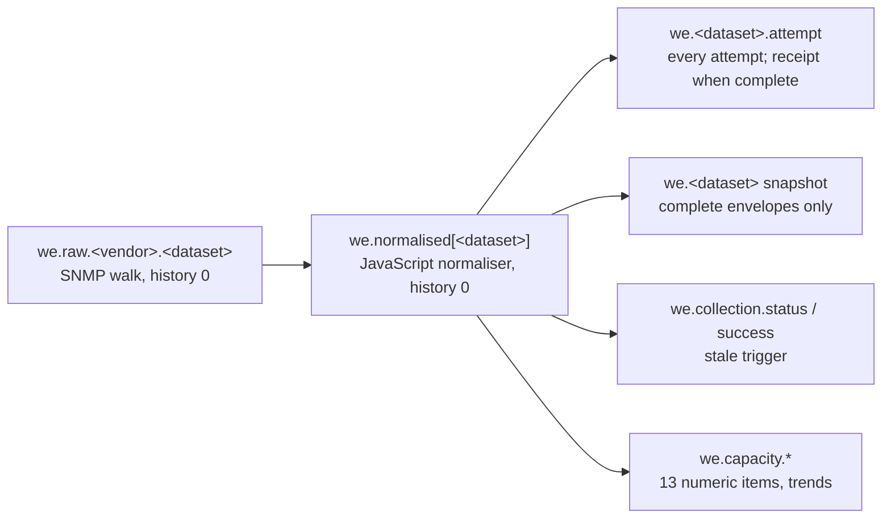

# Wi-Fi AP Zabbix template: requirements specification

Status: requirements for every Wi-Fi Explorer access-point template, written 13 October 2026. The Aruba Instant templates in `templates/native/` are the reference implementation.

## 1. Purpose and scope

A Wi-Fi access-point template is acceptable when it gives Wi-Fi Explorer complete, honest `wifi-1.0` observations for every AP, radio, SSID, client and RF neighbour it can see, and nothing it cannot prove. This specification states what any such template must do, for any vendor. The shipped *Wi-Fi Explorer - Aruba Instant VC by SNMP* and *Aruba Instant AP by SNMP* templates are the reference implementation. Requirement words follow RFC 2119: **must**, **should**, **may**.

- **In scope:** template structure, items and keys, the envelope contract, the eight datasets, capacity items, macros, triggers, privacy, error handling, tests and qualification, for Zabbix 7.0, 7.2 and 7.4.
- **Out of scope:** the Wi-Fi Explorer frontend, switch-side collection (Network Explorer's templates own LLDP, VLAN and STP), and controller APIs that need a stored token.
- **Readers:** whoever builds or reviews a template for a new vendor family, and whoever qualifies one against real hardware.
- **Sources:** `docs/wifi-explorer/REQUIREMENTS.md`, `docs/wifi-explorer/DESIGN.md`, `schemas/wifi-envelope-1.0.schema.json` and `templates/generate_wifi.py` in sjackson0109/ZabbixModules, as of `main` after PR #25.

## 2. Principles the template must not break

These come from section 37 of the requirements and decide every rule below.

| ID | Requirement |
| --- | --- |
| P1 | **Never fabricate.** A value the device does not report is `null`, never a default, a guess or a value copied from another object. |
| P2 | **Unknown is never healthy.** A failed, partial or stale poll must never make an AP, radio or SSID look up. |
| P3 | **A gap is never a zero.** A capacity or count item must have no value for a poll that was not complete. |
| P4 | **Inferred is labelled.** Anything derived rather than read (a band from a channel, an AP from an address) carries its basis. |
| P5 | **No credentials in the template.** No SNMP community, v3 secret, API token or password as a template macro value. |
| P6 | **No global privileged token.** No API relay, script or item that reads Zabbix as a privileged user. |
| P7 | **No per-client items or discovery.** Clients are one bounded snapshot per cluster, never one item per client. |
| P8 | **No "malicious".** The vendor's own RF classification is kept as the vendor's label, never escalated. |
| P9 | **One owner per fact.** Switch LLDP, VLAN and STP belong to Network Explorer's templates; the AP template does not re-collect them. |

## 3. Template structure and host model

A vendor family must ship two templates: a cluster template for whatever answers for the whole Wi-Fi system, and an optional per-AP template for what only an AP can see.

| Template | Linked to | Datasets | Required |
| --- | --- | --- | --- |
| *Wi-Fi Explorer - \<Vendor> \<family> VC by SNMP* (cluster) | One host per cluster or controller, at its management or virtual-controller address | `device`, `ap_inventory`, `ap_state`, `radio_inventory`, `radio_state`, `ssid`, `client` | Must |
| *Wi-Fi Explorer - \<Vendor> \<family> AP by SNMP* (per AP) | One host per AP whose RF view is wanted, at the AP's own address | `rf_neighbour` | Should, where the vendor exposes neighbour scans per AP |

- **S1.** Templates must be generated from one source (`templates/generate_wifi.py` and `templates/source/wifi/datasets.json`), never edited by hand, for 7.0, 7.2 and 7.4 (`templates/native/<version>/wifi_explorer_snmp.yaml`). `--check` must fail when a committed file differs from the generator.
- **S2.** Both templates must sit in the template group *Templates/Wi-Fi Explorer* and carry the tag `component: wifi-explorer`.
- **S3.** All keys must start with `we.` and follow the key table in section 4. A vendor's raw items may add a vendor segment (`we.raw.<vendor>.<dataset>`).
- **S4.** The site is the host's `site` tag, the same tag Network Explorer scopes by. The template must not create or set it.
- **S5.** A cluster template linked to a member AP instead of the controller must report its cluster datasets as `unsupported` with a reason, not as empty.
- **S6.** The per-AP host must be named like the AP, or carry the AP's address, so its observations can be matched to the AP. It may also link `Network Explorer - LLDP for access points`, with the same `ne.domain` tag as the switches.
- **S7.** No low-level discovery. AP, radio and client counts change too often and too widely for one item per object (P7).
- **S8.** The cluster template should carry an inherited host dashboard built only from Zabbix's own widgets (Item value, Graph) over the capacity items of section 6: APs up and down, clients and the most on one AP, channel utilisation and radios up by band. It must not need a widget module. Floors, paths, findings and clients stay on the Wi-Fi Explorer page.

## 4. Collection and the envelope contract

Each dataset must be one SNMP walk, turned into one `wifi-1.0` envelope by JavaScript preprocessing, which then feeds a fixed set of dependent items. The page reads only the snapshot, the attempt and the capacity items.

A failed or partial poll still writes an attempt and a status, but never touches the snapshot, the success item or the capacity items.

### 4.1 Items per dataset

| Key | Type | Value | History | Purpose |
| --- | --- | --- | --- | --- |
| `we.raw.<vendor>.<dataset>` | SNMP agent, `walk[<OIDs>]` | Text | 0 | The walk, polled at `{$WE.<DS>.INTERVAL}`; `CHECK_NOT_SUPPORTED` turns an SNMP error into an envelope |
| `we.normalised[<dataset>]` | Dependent | Text | 0 | The normaliser: walk to envelope, once; master of everything below |
| `we.<dataset>.attempt` | Dependent | Text | `{$WE.<DS>.HISTORY}` | Every attempt. A complete one is stored as a receipt (rows dropped, `data_rows` set, `data_omitted: true`) |
| `we.<dataset>` or `we.<dataset>.snapshot` | Dependent | Text | `{$WE.<DS>.HISTORY}` | The last complete envelope only; anything else is discarded |
| `we.collection.status[<dataset>]` | Dependent | Unsigned, value map *collection status* | 31d | 0 ok, 1 partial, 2 failed, 3 unsupported |
| `we.collection.success[<dataset>]` | Dependent | Unsigned | 31d | 1 for a complete observation, discarded otherwise; carries the stale trigger |

- **C1.** The normaliser must run once per poll (`we.normalised[…]`), not once per dependent item.
- **C2.** The snapshot must keep its previous value when a poll is not complete (discard, never overwrite with a partial).
- **C3.** A receipt must never be used in place of a snapshot. Readers fall back to the snapshot.
- **C4.** Item timeouts and walk size must fit the busiest supported cluster; a timeout is a failed attempt, never an empty success.

### 4.2 Envelope fields

Every envelope must validate against `schemas/wifi-envelope-1.0.schema.json`.

| Field | Rule |
| --- | --- |
| `schema_version` | `wifi-1.0` |
| `dataset` | One of the eight datasets |
| `generation_id` | New per attempt |
| `attempted_at`, `observed_at` | UTC times; `observed_at` is when the device answered, `null` if it did not |
| `status` | `ok`, `partial`, `failed` or `unsupported` |
| `complete` | `true` only when every row the walk should hold was read |
| `source` | `method` (`native_snmp` for these templates), `adapter`, `version`, `source_instance` |
| `capability` | `state` (`supported`, `partial`, `unsupported`, `unknown`) and a `reason` |
| `errors`, `warnings` | Up to 256 `{code, message}`, codes `^[a-z0-9_]{1,64}$` |
| `data` | Up to 50,000 rows, empty in a receipt |
| `data_rows`, `data_omitted` | Receipts only |

- **C5.** `status: ok` requires `complete: true`. A walk that returns some tables but not others is `partial` with an error per missing table.
- **C6.** Unknown keys are refused by the schema, so a vendor-specific extra must not be added to a row; it belongs in a future schema version.

## 5. Dataset requirements

Every row must carry every field its schema definition requires. A field the vendor does not expose is `null`, never left out and never filled from elsewhere.

| Dataset | Template | Default interval / stale / history | One row per | Required fields |
| --- | --- | --- | --- | --- |
| `device` | Cluster | 1 h / 3 h / 7 d | The answering system | `hostname`, `description`, `sys_object_id`, `vendor`, `platform`, `role`, `controller_address`, `firmware`, `uptime_s` |
| `ap_inventory` | Cluster | 1 h / 3 h / 7 d | AP | `ap_uid`, `mac_address`, `name`, `ip_address`, `serial`, `model`, `firmware` |
| `ap_state` | Cluster | 5 min / 15 min / 1 d | AP | `ap_uid`, `status`, `uptime_s`, `cpu_percent`, `memory_used_percent` |
| `radio_inventory` | Cluster | 1 h / 3 h / 7 d | Radio | `radio_uid`, `ap_uid`, `radio_index`, `bssid` |
| `radio_state` | Cluster | 5 min / 15 min / 1 d | Radio | `radio_uid`, `ap_uid`, `status`, `band`, `channel`, `channel_width`, `tx_power_dbm`, `noise_floor_dbm`, `utilisation_percent`, `utilisation_window_s` |
| `ssid` | Cluster | 5 min / 15 min / 1 d | SSID name | `ssid_uid`, `name`, `enabled`, `hidden`, `client_count`, `vlan_id`, `security`, `profiles` |
| `client` | Cluster | 5 min / 15 min / 1 d | Associated client | `client_uid`, `mac_address`, `ip_address`, `name`, `identifiers`, `ap_uid`, `ap_basis`, `bssid`, `snr_db`, `connected_s` |
| `rf_neighbour` | Per AP | 15 min / 45 min / 1 d | Detected BSSID | `bssid`, `ssid`, `channel`, `band`, `channel_width`, `phy`, `encryption`, `snr_db`, `classification`, `classification_raw` |

### 5.1 Identities

- **D1.** `ap_uid` must be `ap-` + the first 24 hex digits of SHA-256(`ap:` + the AP's base MAC, lower case, colon separated). `radio_uid` must be `radio-` + the first 24 hex digits of SHA-256(`radio:` + AP MAC + `:` + radio index). Neither may use a name, serial or IP address, so both survive renames, readdressing and controller elections.
- **D2.** `ssid_uid` is derived from the SSID name the same way. `client_uid` follows the client policy (section 9).
- **D3.** An AP whose MAC cannot be read must be left out with a warning, never given an identity from another field.

### 5.2 Values that must never be guessed

- **D4. State.** `ap_state.status` and `radio_state.status` are `up`, `down` or `unknown`. A vendor state that is not plainly up or down (provisioning, upgrading, rebooting) is `unknown` with its raw value in a warning.
- **D5. Band.** `2.4`, `5`, `6` or `null`. A band may come from the channel number only where the number proves it (1–14 is 2.4 GHz; 178–233 is 6 GHz; 32–177 is 5 GHz only on an AP with at most two radios). On a tri-radio AP an ambiguous channel gives `null` and the warning `radio_band_ambiguous`. A vendor band field, where one exists, wins.
- **D6. Width.** `20`, `40`, `80`, `160`, `80+` (when the MIB cannot tell 80 from 160) or `null`.
- **D7. Utilisation.** The channel utilisation the device measured, with `utilisation_window_s` set to its averaging window. A derived or estimated airtime figure must not be put in this field.
- **D8. SSID VLAN and security.** `vlan_id` and `security` are `null` unless the device states them; a VLAN from configuration belongs in Wi-Fi Explorer's declared intent, not in the dataset.
- **D9. Client to AP.** `ap_basis` must say how the AP was found (`ap_address`, `ap_address_unmatched`); `bssid` is the client's exact BSSID or `null`.
- **D10. RF classification.** `classification` is the vendor's label mapped to the enum, and `classification_raw` keeps the vendor's own word.

### 5.3 Bounds

- **D11.** `rf_neighbour` must be deduplicated by BSSID (strongest SNR kept) and capped at the strongest 500 rows. `client` must be capped at 4,000 rows. Keeping the strongest 500 neighbours is by design, so a bounded RF snapshot stays complete but carries the warning `neighbours_bounded`. More than 4,000 clients is an error (`clients_over_limit`) and the snapshot is incomplete. Rows are never dropped silently.
- **D12.** The AP's own BSSIDs must not be reported as its neighbours.

## 6. Capacity items and trends

The cluster template must carry 13 numeric capacity items so Zabbix builds hourly trends for the Capacity tab. Each is dependent on the normalised envelope and discarded unless that poll was complete (P3).

| Key | Value | Unit | From | Meaning |
| --- | --- | --- | --- | --- |
| `we.capacity.aps.up` | Unsigned | APs | `ap_state` | APs reporting up |
| `we.capacity.aps.down` | Unsigned | APs | `ap_state` | APs reporting down (unknown is not counted) |
| `we.capacity.radios.up[2.4]`, `[5]`, `[6]` | Unsigned | radios | `radio_state` | Radios up per band |
| `we.capacity.utilisation.avg[2.4]`, `[5]`, `[6]` | Float | % | `radio_state` | Mean measured utilisation of the band's up radios |
| `we.capacity.utilisation.max[2.4]`, `[5]`, `[6]` | Float | % | `radio_state` | Highest measured utilisation of any radio in the band |
| `we.capacity.clients` | Unsigned | clients | `client` | Clients associated |
| `we.capacity.clients.ap_max` | Unsigned | clients | `client` | Most clients on one AP |

- **K1.** History is `{$WE.CAPACITY.HISTORY}` (default 7d) and trends `{$WE.CAPACITY.TRENDS}` (default 365d).
- **K2.** A utilisation item for a band where no up radio reports utilisation, and `clients.ap_max` when no client is matched to an AP, must store nothing for that poll, never 0. Counts (APs, radios, clients) of a complete poll may be a real 0.
- **K3.** Radios of unknown band are not counted in any band.
- **K4.** The keys and their meaning are part of the contract: a vendor template must produce all 13 with the same units, so a mixed estate trends on one scale.

## 7. Macros, intervals, retention and storage

Every interval, staleness limit and retention period must be a template macro that a host or global macro can override. Defaults below are the reference template's.

| Macro | Default | Purpose |
| --- | --- | --- |
| `{$WE.<DS>.INTERVAL}` | 1h for `device`, `ap_inventory`, `radio_inventory`; 5m for `ap_state`, `radio_state`, `ssid`, `client`; 15m for `rf_neighbour` | Poll interval of the raw walk |
| `{$WE.<DS>.STALE}` | 3 × the interval (3h, 15m, 45m) | Age after which the dataset is stale: the page shows its objects as unknown and the trigger fires |
| `{$WE.<DS>.HISTORY}` | 7d for hourly datasets, 1d for the rest | Retention of attempts and snapshots |
| `{$WE.CAPACITY.HISTORY}` | 7d | Retention of capacity values |
| `{$WE.CAPACITY.TRENDS}` | 365d | Retention of capacity trends |
| `{$WE.CLIENT.IDENTIFIERS}` | `partial` | Client privacy policy (section 9) |
| `{$WE.CLIENT.KEY}` | empty | Secret key for client IDs, set as a secret macro on the host or globally |

`<DS>` is the dataset in upper case with `_` as `.`, for example `{$WE.AP.STATE.INTERVAL}`.

- **M1.** No macro may hold a credential with a value in the template (P5). SNMP credentials are set on the host or globally.
- **M2.** Every macro must have a description saying what it controls and its unit.
- **M3.** Storage must stay within the budget the design measures: about 19 MB written per day and 25 MB held at default history for a 100-AP, 200-radio cluster's inventory and state datasets, about 110 MB per day for a 1,500-client cluster's client dataset, and about 10 MB per AP per day for RF. A vendor template that exceeds these by more than half must say why in its design note.
- **M4.** Each dataset is polled once (one walk), however many items it feeds. Two items must not walk the same table.

## 8. Triggers and problem events

The template must raise exactly one kind of problem: a dataset that has had no complete observation for its stale limit. Operational findings (an AP down, a radio at 82% utilisation, a VLAN missing on a path) are raised by Wi-Fi Explorer from evidence, not by template triggers.

- **T1.** One trigger per dataset on `we.collection.success[<dataset>]`, Warning: `nodata(…/we.collection.success[<dataset>],{$WE.<DS>.STALE})=1 and last(…/we.collection.status[<dataset>])<>3`, named *Wi-Fi Explorer: no complete \<dataset> observation for {$WE.\<DS>.STALE}*.
- **T2.** Partial and failed attempts must not reset the age; an `unsupported` dataset (a member AP, a missing MIB) must not alert.
- **T3.** Tags on every trigger: `component: wifi-explorer`, `dataset: <dataset>`, `data_source: native-snmp`.
- **T4.** No trigger on AP down, radio down, client count or utilisation. Those depend on site intent and evidence the template cannot see, and duplicating them would page twice.
- **T5.** A vendor may add a trigger only for a device fault with no Wi-Fi Explorer equivalent (for example a controller licence expiry), at Information or Warning, tagged as above.

## 9. Privacy and security

Client data must be masked inside preprocessing, before anything is stored, according to `{$WE.CLIENT.IDENTIFIERS}`.

| Policy | `mac_address` | `ip_address` | `name` | `client_uid` |
| --- | --- | --- | --- | --- |
| `full` | Kept | Kept | Kept | Keyed hash of the MAC |
| `partial` (default) | Manufacturer prefix only (first three octets) | `null` | `null` | Keyed hash of the MAC |
| `pseudonymised` | `null` | `null` | `null` | Keyed hash of the MAC |

- **V1.** `{$WE.CLIENT.KEY}` must be expanded only inside the preprocessing call, never named in a comment, message or stored value. An unknown policy value is treated as `partial`, and `pseudonymised` without a key falls back to `partial`. With no key the snapshot carries the warning `client_key_missing`, because an unkeyed hash of a MAC can be reversed.
- **V2.** Every client row must state its `identifiers` policy; the validator refuses a row that holds more than its policy allows.
- **V3.** No per-client item, trigger, tag or inventory field anywhere (P7).
- **V4.** No credential, token, PSK or RADIUS secret in the template, its macros, its preprocessing or its sample data (P5). SNMPv3 is preferred; the template must work with v2c and v3 set on the host.
- **V5.** No item may call the Zabbix API, a script, an external check or a URL. The template reads the device only.
- **V6.** Sample walks committed for tests must be sanitised: AP names, serials, client MACs and public addresses replaced, as `capture_walk.py --profile <vendor>` does.

## 10. Errors, partial data and unsupported hosts

Every way a poll can go wrong must end in an envelope that says so, so the page can show unknown rather than stale or empty.

| Situation | `status` | `complete` | Snapshot | Required signal |
| --- | --- | --- | --- | --- |
| Every expected table read | `ok` | `true` | Replaced | None |
| Some tables or columns missing, or a row cap hit as an error | `partial` | `false` | Kept as it was | An error per missing table, for example `clients_over_limit` |
| SNMP timeout, no response, unreadable walk | `failed` | `false` | Kept as it was | `agent_unreachable` (no sysUpTime in the walk) or `collection_failed` (no data, or the item not supported, via `CHECK_NOT_SUPPORTED`) |
| The host is not this vendor's controller (a member AP, another vendor) | `unsupported` | `false` | Kept as it was | `capability.state: unsupported` with a reason, for example `not_aruba_instant` |
| A value the vendor reports in an unexpected form | `ok` or `partial` | as read | as read | A warning naming the field and the raw value; the field is `null` |

- **E1.** Every normaliser must run inside the shared wrapper (`NE.run` via the Wi-Fi runner), so any failure still produces an envelope: a thrown `{unsupported, code}` becomes `unsupported` with that code, and any other exception becomes `failed` with `normaliser_error` and a fixed message that never quotes device data.
- **E2.** A row whose identity cannot be built (no AP MAC, no radio index) is dropped with a warning; the rest of the dataset stays.
- **E3.** A row with a bad value in a non-identity field keeps the row, sets the field to `null` and adds a warning.
- **E4.** Error and warning codes are stable, documented, lower-case identifiers; messages may change.
- **E5.** When the cluster template sees the device is a member rather than the controller, every cluster dataset returns `unsupported` with the same reason, and the page says so once.

## 11. Testing, qualification and acceptance

A vendor template is accepted when every check below passes in CI and its qualification evidence is committed. Support moves past *Unqualified* only with sanitised walks from real hardware.

| Level | What must pass | Where |
| --- | --- | --- |
| Generator | `python templates/generate_wifi.py --check` for 7.0, 7.2, 7.4 | Checks workflow |
| Normaliser unit tests | Every dataset from each fixture walk: rows, identities, nulls, warnings, caps, unsupported and failed walks | `tests/unit/test_wifi.py` |
| Schema | Every envelope from every fixture validates against `wifi-1.0`, and a deliberately wrong one is refused | `tests/unit`, `tests/php` |
| Frontend contract | The PHP services read the fixture envelopes and show unknown for stale, partial and missing data | `tests/php/run.php` |
| Real Zabbix | Template import, replayed datasets, permission filtering and every Wi-Fi Explorer tab, on 7.0, 7.2 and 7.4 | Compatibility workflow (`tests/integration/zabbix_runtime.py`, `tests/browser/wifi.lab.cjs`) |
| Live SNMP | The template polling an SNMP simulator serving the fixture walk: receipts, snapshots and capacity values appear | Local lab (`lab/lab.py`, snmpsim) |
| Qualification | Sanitised walks of each supported model and firmware, with the matrix entry | `qualify.py --product wifi`, `docs/qualification/WIFI_MATRIX.md` |

Acceptance criteria for a new vendor family:

1. Both templates generate and import on 7.0, 7.2 and 7.4 with no manual step.
2. Every required field of every dataset is either read from the device or `null` with a documented reason in the vendor's mapping table.
3. A walk from a member AP, another vendor and an unreachable agent each give the right status (`unsupported`, `unsupported`, `failed`), and no trigger fires for `unsupported`.
4. Stale data shows as unknown in Wi-Fi Explorer within one stale period, and a complete poll clears it.
5. Client data at each privacy policy holds no more than that policy allows.
6. Measured storage on a canary is within section 7's budget, or the difference is explained.
7. A sanitised walk of at least one controller and one AP per supported model and firmware is in the qualification evidence.

## 12. Reference mapping: Aruba Instant, and adding a vendor

The reference templates read AI-AP-MIB (`1.3.6.1.4.1.14823.2.3.3.1`) on the cluster's virtual controller (VC) and on each AP. WLSX tables are absent on Instant. Aruba Instant remains *Unqualified* until sanitised walks from real hardware are committed.

| Dataset | Source table | Not exposed on Instant, so `null` or not checked |
| --- | --- | --- |
| `device` | `system` group, `aiControllerVersion`, `aiVirtualControllerIPAddress` | - |
| `ap_inventory`, `ap_state` | `aiAccessPointEntry` (`.2.1.1`), indexed by AP MAC; VC only | Per-AP firmware (no column in the table; the cluster firmware is on `device`) |
| `radio_inventory`, `radio_state` | `aiRadioEntry` (`.2.2.1`), indexed by AP MAC and radio index | Band on tri-radio APs below channel 178; 80 vs 160 MHz; DFS state; configured vs observed channel and power |
| `ssid` | `aiWlanSSIDEntry` (`.1.7.1`); VC only | SSID-to-VLAN, security mode; per-AP SSID zones |
| `client` | `aiClientEntry` (`.2.4.1`); VC only | The client's SSID; client-to-AP by anything but the AP address column |
| `rf_neighbour` | `aiInterferAccessPointEntry` (`.1.8.1`), on each AP | - |

Also not exposed, so not shown anywhere: PoE, authentication failures, retry and error rates, throughput, PHY and MIMO detail.

Adding a vendor family:

1. Capture sanitised walks of a controller and an AP with `capture_walk.py`, adding a profile for the vendor's MIBs.
2. Write a mapping table like the one above: for every required field, the OID it comes from or the reason it is `null`.
3. Add a normaliser under `templates/source/js/wifi/<vendor>.js` that builds rows only through the shared helpers (identities, bands, client policy, the wrapper), and a family entry in `templates/source/wifi/datasets.json`.
4. Generate both templates, add fixture walks and unit tests, then run section 11 end to end.
5. Record the family in `docs/qualification/WIFI_MATRIX.md` as *Unqualified* until real evidence lands.

Where a vendor's controller API exposes what SNMP does not (SSID VLAN, client SSID), it may be added later only as a separate producer that needs no stored privileged token (P6); it is not part of this template.

## 13. Open questions

- [ ] Which vendor families come next after Aruba Instant (UniFi, Cisco WLC, Aruba OS 8 controllers, others), and in what order?
- [ ] Sanitised Aruba Instant walks (a VC and a member AP, with model and firmware) are still needed before Aruba can be qualified.
- [ ] Should `{$WE.CLIENT.KEY}` be mandatory, so a cluster without it reports clients as `partial` instead of only warning?
- [ ] Is per-AP capacity over time (one set of numeric items per AP) wanted despite the item count, or is per-cluster enough?
- [ ] Should a controller-API producer be specified next, for the SSID VLAN and client SSID that SNMP does not expose?
